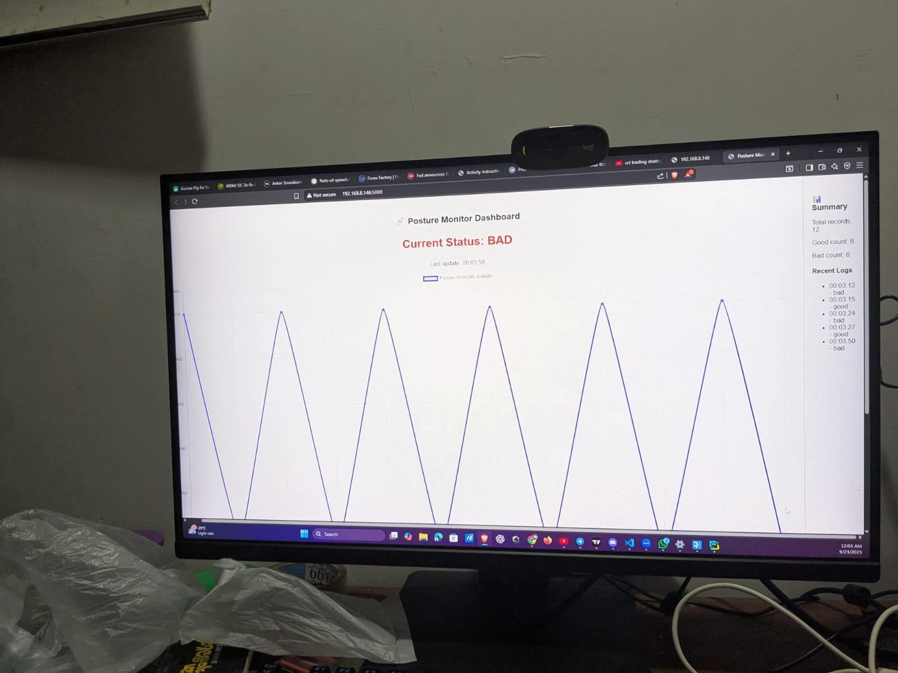
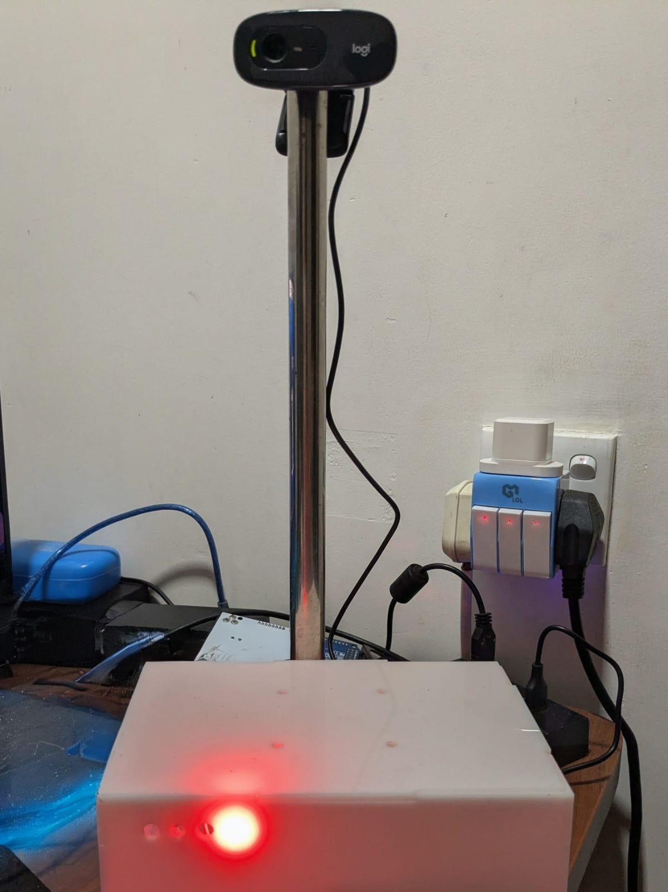
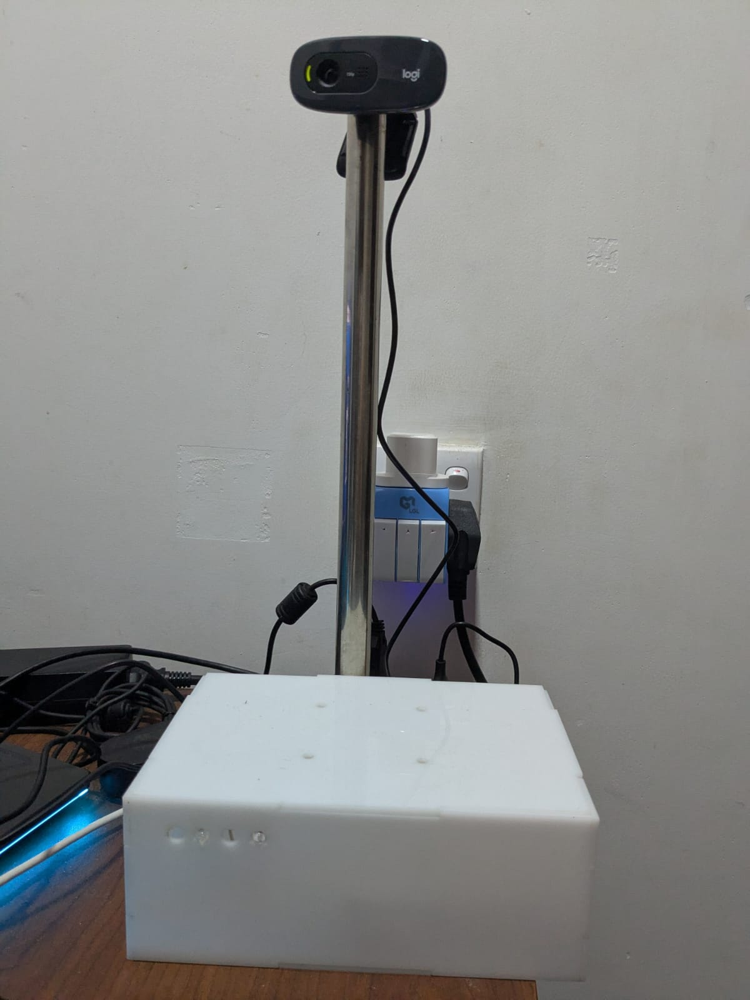
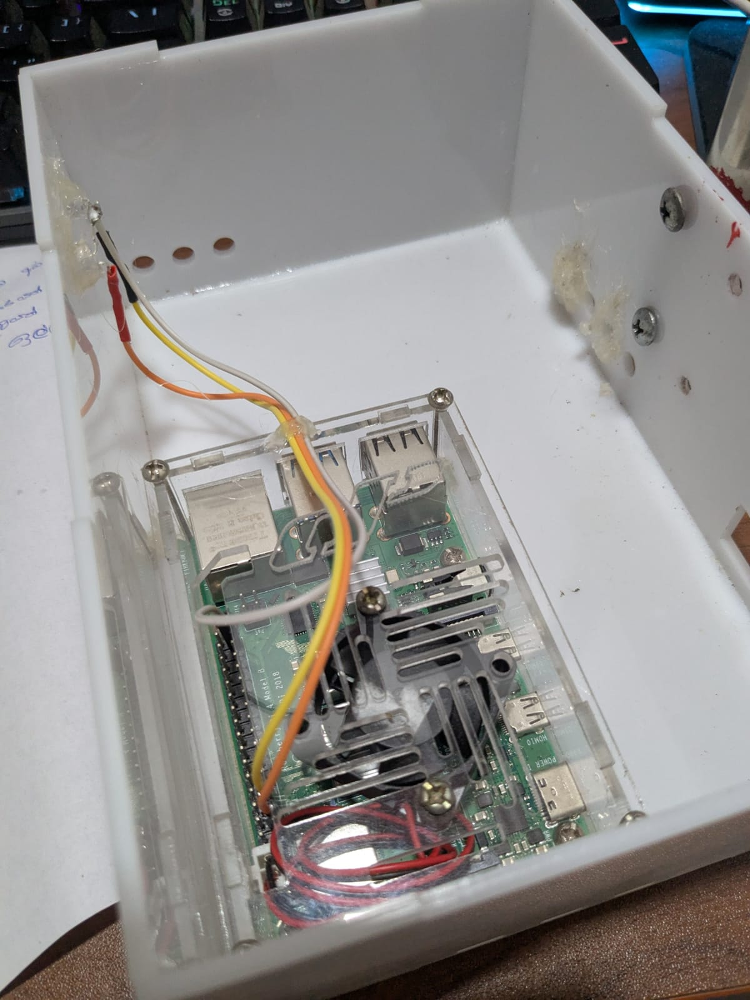

# Vision Bot

Vision Bot is an AI-driven system using a Raspberry Pi, a webcam, and servo motors. It detects a seated person, analyzes their facial features, assesses their condition via AI, and provides work readiness insights or advice.

---

## 📸 Photos

### Photo 1

### Photo 2

### Photo 3

### Photo 4

### Photo 5

---

## 🎥 Videos

- [▶️ Watch Video 1](video1.mp4)
- [▶️ Watch Video 2](video2.mp4)

---

## 👤 Author

Made by **MaDhuManodya**
